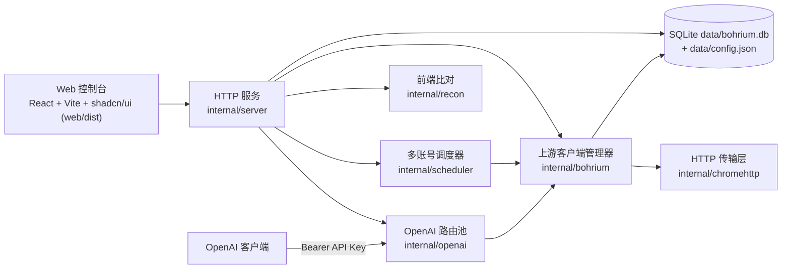

# bohrium-club-auto

自托管多账号调度与 API 代理服务，包含内置 Web 管理控制台、定时任务调度器、本地 SQLite 存储以及 OpenAI 兼容 `/v1/*` 接口层。

文档目录见 [`docs-site/`](docs-site/)。

---

## 使用方式

### 1. Docker Compose

```yaml
services:
  bohrium-club-auto:
    image: ghcr.io/landminehq/bohrium-club-auto:latest
    container_name: bohrium-club-auto
    restart: unless-stopped
    ports:
      - "8788:8788"
    environment:
      BOHRIUM_HOST: "0.0.0.0"
      BOHRIUM_PORT: "8788"
      BOHRIUM_DATA_DIR: "/data"
      TZ: "Asia/Shanghai"
      BOHRIUM_ADMIN_PASSWORD: "replace-with-a-strong-password"
    volumes:
      - bohrium-club-auto-data:/data

volumes:
  bohrium-club-auto-data:
```

启动服务：

```bash
docker compose up -d
docker compose logs -f bohrium-club-auto
```

本地源码构建镜像：

```bash
docker compose up -d --build
```

### 2. 二进制运行

从 Release 下载对应平台压缩包解压后运行：

```bash
tar -xzf bohrium-club-auto-linux-x64.tar.gz
chmod +x bohrium-club-auto
BOHRIUM_ADMIN_PASSWORD="replace-with-a-strong-password" ./bohrium-club-auto
```

Windows 直接运行 `bohrium-club-auto.exe`。默认监听 `http://127.0.0.1:8788/`，持久化数据位于 `./data`（可通过 `BOHRIUM_DATA_DIR` 修改）。

### 3. 首次初始化

1. 访问 `http://127.0.0.1:8788/`，输入 `BOHRIUM_ADMIN_PASSWORD`（未设置时首次启动会自动生成并输出到日志与 `data/config.json`）。
2. 点击 **添加 / 登录账号**，支持微信扫码、第三方 OAuth、验证码、密码或导入 `brmToken`。
3. 在「多账号与签到」查看账号余额、每日任务与随机波动签到计划；如需将该账号纳入 `/v1/*` 路由，前往「OpenAI 路由池」手动拖入右侧路由池。

---

## 功能说明

- **多账号管理与持久化**：使用纯 Go SQLite（`data/bohrium.db`，WAL 模式）存储多账号凭据、独立 `storeId`、余额快照、会话绑定与执行日志，支持旧版 `state.json` / `responses.json` 自动迁移。
- **随机波动定时签到**：支持全部 4 项每日任务（Web 端、桌面端协议任务、文献阅读、学术写作），每个账号按日期计算独立错峰执行槽位，并自动维护 Token 续期。
- **OpenAI 兼容路由池**：
  - 新账号默认不入池，需在控制台手动拖入后才承接 `/v1/*` 流量；
  - 新会话按有效余额比例（个人光子 + 组织余额）加权抽签分配账号，并在 SQLite 中缓存绑定关系，最长保留 7 天后自动清理；
  - 首包前遇到 401/402 自动冷却并切换池内其他可用账号重试；
  - 支持 `/v1/models`、`/v1/balance`、`/v1/chat/completions`、`/v1/responses` 及 `chat_completions` / `responses` 双向兼容桥接。
- **资产与前端检测**：聚合展示光子余额、即将过期批次、流水、配额与知识库存储容量；提供 `recon pull` / `recon diff` 检测上游前端资源变化。

---

## 程序架构



### 目录结构

```text
cmd/bohrium-club-auto/   CLI 入口（serve / recon pull / recon diff / version）
internal/chromehttp/     HTTP 客户端与流式传输封装
internal/config/         config.json 持久化与环境变量覆盖
internal/store/          纯 Go SQLite（多账号、7 天会话绑定、Responses 记录、日志）
internal/prompts/        内置题库、文献目录与桌面端工具定义（go:embed）
internal/bohrium/        多账号认证、任务执行、余额资产与上游协议客户端
internal/openai/         /v1/* 网关、余额加权路由与协议桥接
internal/scheduler/      多账号错峰调度、自动续期与过期绑定清理
internal/recon/          前端资源快照与契约比对
internal/server/         管理员鉴权、管理 API 与内置 SPA 托管
web/                     React + Vite + TypeScript + Tailwind CSS + shadcn/ui 前端工程
docs-site/               VitePress 文档工程
.github/workflows/       构建与发布工作流
```

---

## 配置说明

配置持久化于 `data/config.json`（参见 [`config/config.example.json`](config/config.example.json)），主要环境变量：

| 变量 | 默认值 | 说明 |
| --- | --- | --- |
| `BOHRIUM_HOST` | `0.0.0.0` | 监听地址 |
| `BOHRIUM_PORT` | `8788` | 监听端口 |
| `BOHRIUM_DATA_DIR` | `data`（容器内 `/data`） | 数据目录（`config.json`、`bohrium.db`、`pdfs/`、`custom_pdfs/`） |
| `BOHRIUM_ADMIN_PASSWORD` | 首次启动自动生成 | 控制台与管理 API 密码 |
| `BOHRIUM_SESSION_SECRET` | 首次启动自动生成 | 管理员 Cookie 签名密钥 |
| `BOHRIUM_SCHEDULE_ENABLED` | `true` | 是否开启每日定时调度 |
| `BOHRIUM_SCHEDULE_TIME` | `08:15` | 每日起始基准时间（`HH:MM`） |
| `BOHRIUM_SCHEDULE_TZ` | `Asia/Shanghai` | 调度时区 |
| `BOHRIUM_PROXY` | 空 | 可选出站代理 |
| `BOHRIUM_GATEWAY_ENABLED` | `true` | 是否开启 `/v1/*` 网关 |
| `BOHRIUM_API_KEYS` | 自动生成 | 逗号分隔的 `/v1/*` API Key |
| `BOHRIUM_GATEWAY_DEFAULT_MODEL` | `dspro-high` | 默认模型 |
| `BOHRIUM_GATEWAY_ALLOW_NO_AUTH` | `false` | 是否允许无 Key 访问 `/v1/*` |
| `BOHRIUM_GATEWAY_PREFLIGHT` | `true` | 新对话前执行计费预检 |
| `BOHRIUM_GATEWAY_SCIMASTER_PROMPT` | `true` | 主模型前置系统提示词开关 |
| `BOHRIUM_GATEWAY_RETENTION_DAYS` | `180` | OpenAI 用量看板数据保留天数（1–3650） |

---

## API 列表

### 管理接口（`/api/*`）

鉴权方式：登录后自动下发的 `HttpOnly` Cookie，或请求头 `X-Admin-Password: <password>`。

| 方法 | 路径 | 说明 |
| --- | --- | --- |
| `GET` | `/healthz` | 健康检查（免鉴权） |
| `POST` | `/api/auth/login` / `logout` | 管理员登录与登出 |
| `GET` | `/api/overview` | 控制台总览（账号列表、聚焦账号任务/资产、调度状态、日志） |
| `GET` | `/api/accounts` | 多账号列表与汇总 |
| `PATCH` / `DELETE` | `/api/accounts/{id}` | 修改备注/签到开关/路由池状态，或删除账号 |
| `POST` | `/api/accounts/refresh-balances` | 批量刷新所有账号余额 |
| `POST` | `/api/accounts/run-all` | 立即触发全部启用签到的账号执行每日任务 |
| `POST` | `/api/accounts/{id}/refresh-token` | 手动续期指定账号 Token 并同步资料 |
| `POST` | `/api/accounts/{id}/tasks/{claim-all,claim,run,run-all}` | 领取或执行指定账号的每日任务 |
| `GET` / `POST` | `/api/accounts/{id}/benefits/client-login` & `/claim` | 查询或领取一次性客户端首次登录 10,000 光子礼包（领取前强制状态校验） |
| `POST` | `/api/bohrium/wechat/qr` & `GET /api/bohrium/wechat/poll` | 微信二维码登录与轮询 |
| `POST` | `/api/bohrium/oauth/url` & `oauth/verify` | 第三方 OAuth 登录 |
| `POST` | `/api/bohrium/captcha/prepare` | 获取登录图形验证码初始化参数（供控制台弹出官方腾讯云人机验证组件） |
| `POST` | `/api/bohrium/code/send` & `login/code` | 手机/邮箱验证码登录（支持传入人工验证票据） |
| `POST` | `/api/bohrium/login/password` & `login/token` | 密码登录（支持传入人工验证票据）或导入 `brmToken` |
| `GET` / `PUT` | `/api/settings` | 读取与更新调度及运行参数 |
| `GET` | `/api/logs` | 查询 SQLite 执行日志（支持 `accountId`、`limit`） |
| `GET` / `POST` | `/api/recon/{status,pull,diff}` | 前端快照状态、拉取基线与漂移检测 |
| `GET` / `PUT` | `/api/gateway/{status,settings,pool}` | 网关状态、配置（含数据保留天数）与路由池成员调整 |
| `GET` / `POST` | `/api/gateway/analytics`、`analytics/logs`、`analytics/purge` | 按时间/Key/模型/账号聚合 Token 看板、详细调用记录分页检索（含推理强度/端点/桥接/计费策略/首字 TTFT/IP/UA）与手动清理 |
| `GET` / `DELETE` | `/api/gateway/bindings` & `bindings/{hash}` | 查询、解绑或清空 7 天会话绑定 |
| `POST` / `PATCH` / `DELETE` | `/api/gateway/keys` & `keys/{id}` | 管理 `/v1/*` API Key |
| `POST` | `/api/gateway/{models/refresh,preflight,playground}` | 刷新模型目录、额度预检与在线调试 |

### OpenAI 兼容接口（`/v1/*`）

鉴权方式：`Authorization: Bearer <api-key>`（或 `x-api-key`）。

| 方法 | 路径 | 说明 |
| --- | --- | --- |
| `GET` | `/v1/models` | 获取可用模型目录 |
| `GET` | `/v1/models/{id}` | 查询单个模型信息 |
| `GET` | `/v1/balance` | 路由池聚合余额与账号明细 |
| `POST` | `/v1/chat/completions` | Chat Completions（支持流式 SSE、tools、reasoning、vision） |
| `POST` | `/v1/responses` | Responses API（支持流式 SSE、`previous_response_id` 链式上下文） |
| `GET` / `DELETE` | `/v1/responses/{id}` | 查询或删除已保存的响应记录 |
| `GET` | `/v1/responses/{id}/input_items` | 查询指定响应的输入条目 |

---

## 本地开发与构建

```bash
# 1. 安装并构建 React + Vite + shadcn/ui 前端（产物输出到 web/dist，供 Go embed 嵌入）
npm ci --prefix web
npm run build --prefix web

# 开发模式下可同时运行后端与前端热更新（Vite 自动代理 /api /v1 /healthz 到 127.0.0.1:8788）
npm run dev --prefix web

# 2. Go 检查、测试与静态编译
go vet ./...
go test ./...
CGO_ENABLED=0 go build -trimpath -ldflags="-s -w -X main.Version=dev" -o dist/bohrium-club-auto ./cmd/bohrium-club-auto

# 3. 文档站本地预览与构建
npm ci --prefix docs-site
npm run dev --prefix docs-site
npm run build --prefix docs-site
```

更多编译与发布细节见 [`docs/BINARY-BUILDS.md`](docs/BINARY-BUILDS.md)。

## License

MIT — see [LICENSE](LICENSE).
