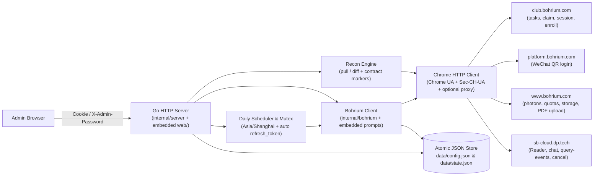

# ⚛️ Bohrium Club Auto — Daily Task Automation & Admin Console for Bohrium Community

**A self-hosted, zero-dependency Go automation service and embedded Web Dashboard for [Bohrium User Community (`club.bohrium.com`)](https://club.bohrium.com/) — featuring remote WeChat QR login, Chrome browser outgoing fingerprint, points & storage capacity monitoring, one-click daily task claiming, real Web API task execution with immediate workflow cancellation, and frontend recon drift checks.**

[](https://go.dev/)
[](https://www.docker.com/)
[](go.mod)
[](LICENSE)
[](https://github.com/LandmineHQ/bohrium-club-auto/actions/workflows/ci.yml)

*Deploy on any Linux/Docker server, scan WeChat QR remotely in your browser, monitor remaining photons, quotas and knowledge-base capacity, and automate all 3 Bohrium Web daily tasks — while skipping the desktop client task and deprecated legacy check-in.*

**Repository:** <https://github.com/LandmineHQ/bohrium-club-auto> · **Docs:** <https://landminehq.github.io/bohrium-club-auto/> · **Actions:** <https://github.com/LandmineHQ/bohrium-club-auto/actions>

[Features](#-key-features) • [Daily Tasks](#-daily-tasks-matrix) • [Quick Start](#-quick-start) • [Architecture](#-architecture) • [Configuration](#%EF%B8%8F-configuration) • [API Surface](#-api-surface) • [Security](#-security--reliability)

---

## 📖 Overview

**Bohrium Club Auto** connects directly to Bohrium's native Web APIs (`club.bohrium.com`, `platform.bohrium.com`, `www.bohrium.com`, and `sb-cloud.dp.tech`) from a single static Go binary (~7.5 MB) with an embedded admin console and embedded scientific prompt/paper corpora.

Instead of keeping a local desktop browser open or running heavy headless Chromium containers, it supports **remote server-side WeChat Official Account QR login**, automatically renews `brmToken` JWT sessions, displays real-time photon balances and capacity metrics, provides one-click claim & manual per-task triggers, and runs scheduled daily Web tasks in `Asia/Shanghai` timezone.

---

## ✨ Key Features

### Remote Authentication & Session Lifecycle

- **Server-side WeChat QR login (recommended)**: Requests official QR codes from `platform.bohrium.com/api/account/wechat/login_qrcode` and polls login status right inside the Dashboard — zero CAPTCHA, zero local machine dependency.
- **Third-party OAuth (Google / Apple / CARSI / Feishu / PKU IAAA)**: Generates official authorization URLs via `/api/account/oauth_url`, opens them in your browser, and exchanges the pasted callback URL (`code=` / `token=`) server-side via `POST /api/oauth/verify`.
- **Phone / Email OTP login**: Sends verification codes via `send_by_phone_v3` / `send_by_email_v3` and logs in via `/api/account/v2/login/{phone_code,email_code}` (without bypassing CAPTCHA if upstream requires it).
- **Optional password login**: Supports phone / email / Account ID (`学术码`) + AES-128-CBC login when `/api/captcha/check_user` returns `skip: true`.
- **Manual `brmToken` import**: Paste raw JWT or cookie strings directly in the login modal; validates against `www.bohrium.com/bohrapi/v1/account/info` and auto-enrolls `club.bohrium.com` binding (`/api/enroll`) if needed.
- **Automatic JWT renewal**: Periodically calls `/platform-gateway/v1/account/refresh_token` in the background before expiration so long-running server deployments stay signed in.

### Points, Quotas & Capacity Dashboard

- **Photons & wallet**: Displays personal photon balance, organization balance & limit, wallet balance, 7-day expiring photon alert, expiring lots breakdown, and recent photon ledger history.
- **Membership & feature quotas**: Shows membership level, expiry date, and remaining counts for Literature Search (`sn.paper`), Knowledge Base Chat (`knowledge_base.chat`), and Deep Research (`sn.deep_research`).
- **Knowledge-base storage**: Visual progress bar and human-readable breakdown of remaining, used, and total storage bytes (`/bohrapi/v1/literature-sage/api/v1/file/capacity`).

### Daily Tasks & Embedded Scientific Corpus

- **One-click claim**: Trigger `POST /api/plaza/tasks/claim` from the Dashboard or automatically before daily runs.
- **Per-task manual triggers & batch run**: Click any Web task individually or run all incomplete Web tasks with one button.
- **Strict task rules**:
  - Automatically skips Task #2 (Desktop Client `体验玻尔科学空间「客户端」`).
  - Never calls the deprecated legacy 200-photon daily check-in endpoint (`/bohrapi/v1/account/user/integral_receive`).
- **870 embedded prompts + 100 real arXiv papers**:
  - 330 Science Space Web questions, 320 Academic Writing requests, and 220 Literature Reading PDF questions compiled via `go:embed`.
  - 100 curated open-access arXiv PDFs cataloged for Task #3 (downloaded on demand with Chrome UA and cached in `data/pdfs/`, plus optional user-supplied PDFs in `data/custom_pdfs/`).
- **Immediate workflow cancellation**: Every Web task submits a real product API request, reports official `query-events` telemetry for its matching `task_key`, and immediately terminates the workflow via `POST /api/v1/chat/<workflowId>/cancel` (`{"source":"api_request"}`).

### Operations, Fingerprint & Recon

- **Desktop Chrome outgoing fingerprint**: Every outbound HTTP request injects Chrome `User-Agent`, `Sec-CH-UA`, `Sec-CH-UA-Mobile`, `Sec-CH-UA-Platform`, and `Accept-Language` — never `Go-http-client`.
- **Admin password protection**: All operational APIs require constant-time verified admin password authentication with rate limiting and HMAC-SHA256 signed `HttpOnly` cookies (or `X-Admin-Password` header for scripts).
- **Frontend recon drift checker**: Built-in `recon pull` / `recon diff` CLI and Dashboard tab snapshot live Bohrium static bundles into gitignored `recon/` and check SHA-256 & API contract markers for upstream changes.
- **Minimal Docker & multi-platform binaries**: Zero third-party Go dependencies, ~7.5 MB static binary, ~15 MB Alpine runtime image.

---

## 📋 Daily Tasks Matrix

| # | Bohrium Plaza Task | `task_key` | Execution Strategy | Immediate Cancel |
| --- | --- | --- | --- | --- |
| 1 | 体验玻尔科学空间「Web端」 | `bohrium_science_space_web` | Random prompt from 330 Science Space prompts → `sb-cloud.dp.tech/api/v1/chat` (`teamId: AgK4D5B8Fdju`) → `query-events` | Yes (`/cancel`) |
| 2 | 体验玻尔科学空间「客户端」 | `bohrium_science_space_client` | **Automatically skipped** | — |
| 3 | 体验玻尔「文献阅读」 | `bohrium_literature_reading` | Random PDF from 100 arXiv papers (or `data/custom_pdfs/`) → `literature-sage` upload → `scix/reader/entries` → random prompt from 220 PDF prompts → `query-events` | Yes (`/cancel`) |
| 4 | 体验玻尔「学术写作」 | `bohrium_academic_writing` | Random prompt from 320 Academic Writing prompts → `sb-cloud.dp.tech/api/v1/chat` (`Referer: /academic-writing`) → `query-events` | Yes (`/cancel`) |

---

## 🚀 Quick Start

### Requirements

- **Option A (recommended): Docker + Docker Compose only.** Use the prebuilt minimal image from GHCR — no Go toolchain, no Node.js, no source build.
- **Option B: nothing on the target machine.** Download a prebuilt static single-file binary for your OS/arch from the latest GitHub Release.

> Building from source is a developer task; see [docs/BINARY-BUILDS.md](docs/BINARY-BUILDS.md).

### Option A — GHCR image with Docker Compose (recommended)

Image: `ghcr.io/landminehq/bohrium-club-auto:latest` (minimal `alpine:3.20` + static Go binary, `linux/amd64` & `linux/arm64`).
Save this as `compose.yml` and run `docker compose up -d`:

```yaml
services:
  bohrium-club-auto:
    image: ghcr.io/landminehq/bohrium-club-auto:latest
    container_name: bohrium-club-auto
    restart: unless-stopped
    ports:
      - "8788:8788"
    environment:
      BOHRIUM_HOST: "0.0.0.0"
      BOHRIUM_PORT: "8788"
      BOHRIUM_DATA_DIR: "/data"
      BOHRIUM_RECON_DIR: "/data/recon/bohrium-web"
      TZ: "Asia/Shanghai"
      # Recommended: set a strong password; leave empty to auto-generate on first start
      BOHRIUM_ADMIN_PASSWORD: "replace-with-a-strong-password"
      BOHRIUM_SCHEDULE_ENABLED: "true"
      BOHRIUM_SCHEDULE_TIME: "08:15"
      BOHRIUM_SCHEDULE_TZ: "Asia/Shanghai"
    volumes:
      - bohrium-club-auto-data:/data
    healthcheck:
      test: ["CMD", "wget", "-q", "-O", "/dev/null", "http://127.0.0.1:8788/healthz"]
      interval: 30s
      timeout: 5s
      start_period: 15s
      retries: 3

volumes:
  bohrium-club-auto-data:
```

```bash
docker compose up -d
docker compose logs -f bohrium-club-auto
```

Or run inline without a compose file:

```bash
docker run -d --name bohrium-club-auto -p 8788:8788 \
  -v bohrium-club-auto-data:/data \
  -e BOHRIUM_ADMIN_PASSWORD="replace-with-a-strong-password" \
  ghcr.io/landminehq/bohrium-club-auto:latest
```

- Dashboard: <http://127.0.0.1:8788/> — health check: `GET /healthz`.
- Persistent volume `/data` stores `config.json`, `state.json`, cached PDFs (`pdfs/`), optional custom PDFs (`custom_pdfs/`), and recon snapshots (`recon/`). Container runs as non-root UID `10001`.
- The repository also ships [`docker-compose.ghcr.yml`](docker-compose.ghcr.yml) (GHCR image) and [`docker-compose.yml`](docker-compose.yml) (local build).

> If `ghcr.io/landminehq/bohrium-club-auto:latest` has not been published yet, run `Actions → publish-docker-image` first (see [Publishing](#publishing)), or use `docker compose up -d --build` from the cloned repository.

### Option B — Download a prebuilt single-file binary (latest release)

Go to the **[latest GitHub Release](https://github.com/LandmineHQ/bohrium-club-auto/releases/latest)** and download the archive for your platform (`CGO_ENABLED=0` static binaries, no external runtime required):

| Platform | Release asset |
| --- | --- |
| Windows x64 | `bohrium-club-auto-windows-x64.zip` |
| Linux x64 (static: glibc & Alpine) | `bohrium-club-auto-linux-x64.tar.gz` |
| Linux arm64 (static: glibc & Alpine) | `bohrium-club-auto-linux-arm64.tar.gz` |
| macOS Intel | `bohrium-club-auto-darwin-x64.tar.gz` |
| macOS Apple Silicon | `bohrium-club-auto-darwin-arm64.tar.gz` |
| Checksums | `SHA256SUMS.txt` |

```bash
# Linux / macOS example
tar -xzf bohrium-club-auto-linux-x64.tar.gz
chmod +x bohrium-club-auto
BOHRIUM_ADMIN_PASSWORD="replace-with-a-strong-password" ./bohrium-club-auto
```

Windows: unzip and run `bohrium-club-auto.exe`.

- Data directory defaults to `./data` next to the working directory (override with `BOHRIUM_DATA_DIR`).
- Unsigned binaries: Windows SmartScreen / macOS Gatekeeper may warn (macOS: `xattr -d com.apple.quarantine ./bohrium-club-auto`).

### First Start

1. Open <http://127.0.0.1:8788/> and sign in with your `BOHRIUM_ADMIN_PASSWORD` (if unset, check the auto-generated password printed in startup logs or `data/config.json`).
2. Click **远程登录玻尔** → **获取 / 刷新二维码** and scan with WeChat on your phone.
3. View remaining photons, storage capacity, and daily tasks on the home tab; click **一键领取每日任务** or **一键执行全部 Web 任务** to verify immediately.

> `/data` contains your admin password and Bohrium session JWT (`brmToken`). Keep permissions `0600` and never commit it.

### Permission error on a bind-mounted `./data`

The container runs as UID/GID **10001:10001**. If you use a host bind mount instead of the default named volume:

```bash
mkdir -p data
sudo chown -R 10001:10001 data
docker compose up -d
```

### Publishing

Release artifacts and container images are published manually via GitHub Actions:

**Container image** — `Actions → publish-docker-image`:

```text
version: v0.1.0        # required, Docker tag rules (letters/digits/._-)
also_latest: true      # optionally also tag :latest
```

- Builds `Dockerfile` for `linux/amd64,linux/arm64` and pushes `ghcr.io/landminehq/bohrium-club-auto:<version>`.

**Binaries** — `Actions → publish-binaries`:

```text
version: v0.1.0        # required; release tag and asset version
prerelease: false      # true = pre-release (excluded from /releases/latest)
draft: false           # true = create as draft
```

- Compiles all 5 platforms natively, attaches `.zip`/`.tar.gz` archives plus `SHA256SUMS.txt`, and generates a release download table.

**Docs site** — `Actions → Deploy docs`:

- Automatically builds `docs-site/` (VitePress) and deploys to <https://landminehq.github.io/bohrium-club-auto/> on pushes to `main` touching `docs-site/**` or manual dispatch.

---

## 📐 Architecture



- **Stdlib-only Go 1.24**: Zero external Go modules in `go.mod`; embeds IANA tzdata (`time/tzdata`), all 870 prompts, 100 arXiv paper metadata records, and the full dashboard SPA directly into the executable.
- **Mutex-protected execution**: Manual dashboard triggers and scheduled daily runs share a single lock in `internal/scheduler`, preventing duplicate runs.
- **Graceful shutdown**: Handles `SIGTERM`/`SIGINT` cleanly, stopping the scheduler and draining in-flight HTTP requests.

---

## ⚙️ Configuration

Configuration is stored atomically in `data/config.json` (editable in the Dashboard) and overridden by environment variables:

| Variable | Default | Description |
| --- | --- | --- |
| `BOHRIUM_HOST` | `0.0.0.0` | Listen address |
| `BOHRIUM_PORT` | `8788` | HTTP listen port |
| `BOHRIUM_DATA_DIR` | `data` (`/data` in Docker) | Persistent data directory (`config.json`, `state.json`, `pdfs/`, `custom_pdfs/`) |
| `BOHRIUM_ADMIN_PASSWORD` | auto-generated | Admin password for Dashboard & API (also accepts `ADMIN_PASSWORD`) |
| `BOHRIUM_SESSION_SECRET` | auto-generated | HMAC-SHA256 signing secret for admin cookies |
| `BOHRIUM_SCHEDULE_ENABLED` | `true` | Enable daily scheduled execution |
| `BOHRIUM_SCHEDULE_TIME` | `08:15` | Daily trigger time (`HH:MM`, 24-hour) |
| `BOHRIUM_SCHEDULE_TZ` | `Asia/Shanghai` | Scheduler timezone |
| `BOHRIUM_USER_AGENT` | Chrome 136 Windows UA | Outgoing Chrome User-Agent override |
| `BOHRIUM_PROXY` | empty | Optional HTTP/HTTPS outbound proxy (`HTTPS_PROXY` / `HTTP_PROXY` fallback) |
| `BOHRIUM_RECON_DIR` | `recon/bohrium-web` | Local recon baseline snapshot directory |

Additional runtime fields in `data/config.json` (see [`config/config.example.json`](config/config.example.json)):

| Field | Default | Description |
| --- | --- | --- |
| `schedule.jitterMinutes` | `15` | Deterministic per-day random delay (0–120 min) |
| `schedule.autoClaim` | `true` | Automatically claim unclaimed daily tasks before running |
| `schedule.autoRefresh` | `true` | Background `refresh_token` renewal |
| `taskDelaySec` | `3` | Pause between sequential Web tasks |
| `cancelAfterMs` | `450` | Delay before invoking `cancelWorkflow` after chat acceptance |
| `maxPdfSizeBytes` | `26214400` (25 MB) | Max PDF file size accepted for Task #3 |

---

## 📚 API Surface

All `/api/*` operational endpoints require either an authenticated admin cookie (`POST /api/auth/login`) or the `X-Admin-Password` header:

| Method | Path | Description |
| --- | --- | --- |
| `GET` | `/healthz` | Public health status, build version, and active Chrome UA |
| `POST` | `/api/auth/login` | Admin password login (rate-limited, sets `HttpOnly` cookie) |
| `GET` | `/api/overview` | Aggregated session, points/capacity, daily tasks, scheduler status, logs |
| `POST` | `/api/bohrium/wechat/qr` | Request official WeChat QR code for remote login |
| `GET` | `/api/bohrium/wechat/poll` | Poll WeChat QR login status and persist `brmToken` |
| `POST` | `/api/bohrium/oauth/url` | Fetch official OAuth URL (`google` / `apple` / `carsi` / `feishu` / `pku`) |
| `POST` | `/api/bohrium/oauth/verify` | Exchange OAuth callback URL/code via `/api/oauth/verify` |
| `POST` | `/api/bohrium/code/send` / `login/code` | Send phone/email OTP and log in with verification code |
| `POST` | `/api/bohrium/login/token` | Import and validate manual `brmToken` |
| `POST` | `/api/bohrium/refresh-token` | Trigger immediate JWT refresh |
| `GET` | `/api/tasks` | Fetch current daily tasks list |
| `POST` | `/api/tasks/claim-all` | Claim all daily tasks in one click |
| `POST` | `/api/tasks/run` | Manually execute a single Web task (auto-claims if needed, skips client task) |
| `POST` | `/api/tasks/run-all` | Claim and run all incomplete Web tasks sequentially |
| `GET` | `/api/assets` | Fetch photons, wallet, 7-day expiring lots, ledger, quotas, and storage capacity |
| `GET` / `PUT` | `/api/settings` | Read or update schedule, UA, proxy, cancel timing, and admin password |
| `POST` | `/api/recon/pull` / `/api/recon/diff` | Pull local frontend snapshot baseline or check live upstream drift |

Full endpoint docs: <https://landminehq.github.io/bohrium-club-auto/api/admin>

---

## 🛡️ Security & Reliability

- **Constant-time password check & rate limit**: Admin login hashes passwords with SHA-256 and compares with `subtle.ConstantTimeCompare`; repeated failures are rate-limited per client IP.
- **Token redaction**: Full `brmToken` JWT strings are never returned back through dashboard APIs; `config.json` and `state.json` are written atomically with `0600` permissions.
- **No CAPTCHA circumvention**: Password login stops gracefully whenever upstream requires Tencent Captcha and instructs the user to use official WeChat QR login.
- **Offline / restricted-network resilience**: Task #3 caches downloaded arXiv PDFs in `data/pdfs/`, prioritizes user-provided PDFs in `data/custom_pdfs/`, retries across multiple catalog papers and mirrors, and falls back to a valid minimal PDF if external arXiv access is blocked.
- **Zero false-positive recon diffs**: HTML hashing strips ephemeral per-request edge CDN `clientSignal` and `nonce` attributes while checking static bundle SHA-256 digests and API contract markers.

---

## 🧪 Development & Verification

```bash
# Static analysis & full test suite (all unit tests run offline via httptest)
go vet ./...
go test -race -v ./...

# Build static single-file binary
CGO_ENABLED=0 go build -trimpath -ldflags="-s -w -X main.Version=dev" \
  -o dist/bohrium-club-auto ./cmd/bohrium-club-auto

# Start server locally
./dist/bohrium-club-auto serve

# Pull & diff upstream Bohrium frontend snapshot (writes only to gitignored /recon/)
./dist/bohrium-club-auto recon pull
./dist/bohrium-club-auto recon diff --json

# Preview or build VitePress documentation site
npm ci --prefix docs-site
npm run dev --prefix docs-site
npm run build --prefix docs-site
```

---

## 📁 Project Layout

```text
cmd/bohrium-club-auto/     CLI entry point (serve, recon pull, recon diff, version)
internal/chromehttp/       Chrome browser User-Agent & Client Hints HTTP client
internal/config/           Atomic config.json management, env overrides, first-boot password
internal/store/            Atomic state.json persistence (auth, schedule day, logs)
internal/prompts/          go:embed 870 scientific prompts + 100 real arXiv papers catalog
internal/bohrium/          Bohrium auth, daily tasks, assets/capacity, PDF pool, task executor
internal/scheduler/        Daily Asia/Shanghai scheduler + periodic token auto-refresh
internal/recon/            Live Bohrium frontend snapshot & diff engine
internal/server/           Admin password gate, rate limiter, REST API, embedded SPA router
web/                       Embedded Web Dashboard SPA (HTML / CSS / vanilla JS)
docs/                      Binary build guide & recon snapshot specification
docs-site/                 VitePress documentation site source
config/                    Sample configuration file
.github/workflows/         CI, binary build/release, Docker build/GHCR push, recon & docs deploy
data/                      Runtime data (gitignored; contains secrets & PDF cache)
recon/                     Local frontend recon snapshots (gitignored)
```

---

## 📄 Documentation Index

| Document | Content |
| --- | --- |
| [Online Docs (VitePress)](https://landminehq.github.io/bohrium-club-auto/) | Full user guide, API reference, configuration, and deployment docs |
| [`docs/BINARY-BUILDS.md`](docs/BINARY-BUILDS.md) | Multi-platform static binary & Docker build/release guide |
| [`docs/RECON-SNAPSHOT.md`](docs/RECON-SNAPSHOT.md) | Pull/compare local Bohrium web-source snapshots (`recon pull` / `recon diff`) |
| [`config/config.example.json`](config/config.example.json) | Annotated configuration example |
| [`AGENTS.md`](AGENTS.md) | Engineering invariants & contributor guide |

---

## ⚠️ Disclaimer

This project is an independent self-hosted automation tool created for **personal convenience, educational, and research purposes**. It is **not affiliated with, endorsed by, or associated with Bohrium or DP Technology**. Please respect Bohrium's terms of service; upstream web APIs may change at any time.

## 📝 License

MIT — see [LICENSE](LICENSE).
